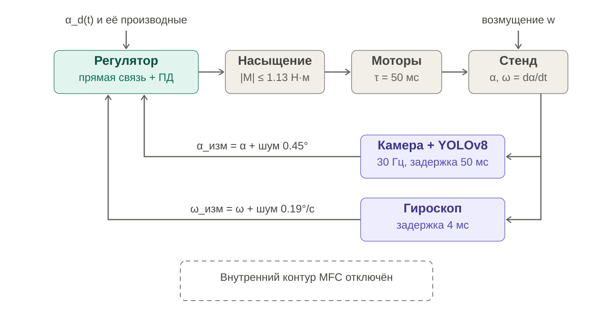
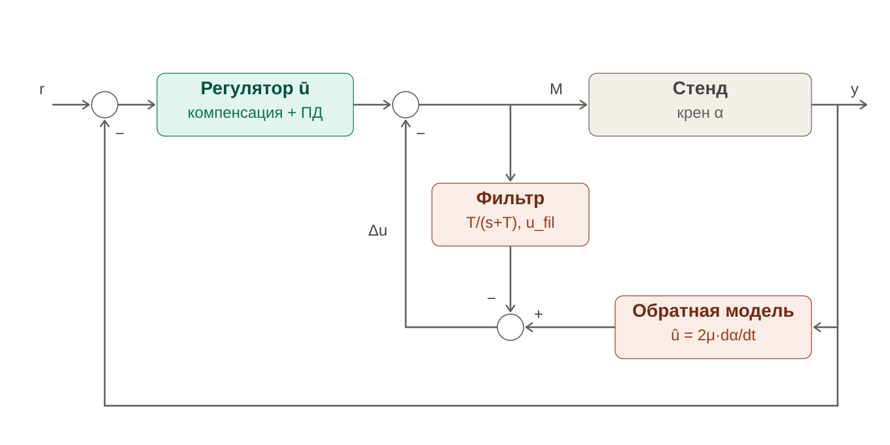

# stand_study — канал крена с ограничениями реального стенда

Модель канала крена из ВКР, дополненная тем, что будет на реальной установке: шум измерений (а не шум состояния), ограничение момента, дискретный такт регулятора, камера с конечной частотой кадров и задержкой, задержка гироскопа, инерция моторов. На этой модели подобраны $\omega_n$ и $\zeta$, пригодные для переноса на стенд.



## Запуск (Windows, из корня репозитория)

```
cd stand_study
python main.py
python stand_feasibility.py
python compare_with_uav_mfc.py
```

В PyCharm рабочая папка конфигурации запуска — `stand_study`. Нужен Python 3.10+.

- `main.py` — один прогон рабочего варианта для стенда: печатает $a$, $b$, RMSE, максимальную ошибку, момент и долю насыщения, строит графики.
- `stand_feasibility.py` — сравнение параметров ВКР с подобранными, перебор $(\omega_n, \zeta)$ на модели стенда, чувствительность к задержке камеры и инерции моторов; график сохраняется в `results/` (папка не хранится в git).
- `compare_with_uav_mfc.py` — сверка с пакетом `uav_mfc` на параметрах ВКР.

## Модель

Объект: $J\ddot\alpha = M + G\sin\alpha - 2\mu\dot\alpha + w$, $J = 0.02$, $G = 0.3$, $\mu = 2.5\cdot10^{-3}$ (ICSC). Объект интегрируется по истинному состоянию с шагом $dt = 10^{-3}$ с; регулятор видит только измерения $\alpha_{изм} = \alpha + \xi$, $\omega_{изм} = \dot\alpha + \eta$.

Закон управления (рабочий вариант, `inner_loop="none"`, `feedforward=True`):

$$M = J\big(\ddot\alpha_d + a(\omega_{изм} - \dot\alpha_d) + b(\alpha_{изм} - \alpha_d)\big) - G\sin\alpha_{изм} + 2\mu\,\omega_{изм},\qquad a = -2\zeta\omega_n,\ b = -\omega_n^2.$$

Параметры: $\omega_n = 15$, $\zeta = 2$, то есть $a = -60$, $b = -225$ ($K_p = 4.5$ Н·м/рад, $K_d = 1.2$ Н·м·с/рад). Параметры ВКР ($\omega_n = 100$, $\zeta = 1.01$, $a = -202$, $b = -10^4$) сохранены в `config.py` как `THESIS_OMEGA_N`, `THESIS_ZETA` и используются для сверки.

## Параметры стенда: данные и допущения

| Параметр | Значение | Источник |
|---|---|---|
| Шум угла (камера + YOLOv8) | СКО 0.45°, среднее 0 | ICSC: RMSE 0.45° в диапазоне 0–5°; RMSE принят за СКО (допущение: нет смещения) |
| Шум гироскопа | СКО 0.19°/с, среднее 0 | 1 % размаха $\dot\alpha_d$ (по Hatamleh et al., 2009); близко к паспорту MPU-6500 (0.01 °/с/√Гц) |
| Возмущение момента | СКО 0.004 Н·м | ВКР |
| Плечо мотора | 0.23 м | ВКР, приложение (расчёт инерции) |
| Тяга при ШИМ 1600 / 1150 | 5.5 / 0.6 Н | рис. 23 ВКР; 5.5 Н — экстраполяция (точки измерены до ≈1540) |
| Предел момента | ±1.127 Н·м | **допущение**: крен создаёт одна пара моторов, один на максимуме, другой на минимуме |
| Такт регулятора | 20 мс (50 Гц) | **допущение** |
| Камера | 30 кадров/с, задержка 50 мс | **допущение** |
| Задержка гироскопа | 4 мс | **допущение** |
| Постоянная времени моторов | 50 мс | **допущение** |

Допущения нужно заменить измерениями на стенде; после этого перезапустить `stand_feasibility.py`.

## Результаты (модель стенда, шум датчиков, среднее по 3 зёрнам)

| Вариант | RMSE, ° | max, ° | Насыщение |
|---|---|---|---|
| ВКР: $\omega_n = 100$, $\zeta = 1.01$, MFC | расходится | — | 20 % тактов |
| Рабочий: $\omega_n = 15$, $\zeta = 2$, прямая связь, без MFC | 0.53 | 1.15 | 0 % |
| Рабочий на идеальном контуре (1 кГц, без задержек) | 0.022 | 0.08 | 0 % |

Почему $\omega_n = 100$ нереализуема: шум датчиков сам по себе даёт разброс момента $\sqrt{(K_p\sigma_\alpha)^2 + (K_d\sigma_\omega)^2} \approx 1.57$ Н·м, больше предела 1.13 Н·м; задержка камеры 50 мс отнимает на частоте 100 рад/с около 5 рад фазы. Снизу частоту ограничивает неустойчивый полюс объекта $s \approx 3.75$ рад/с, сверху — полоса моторов $1/\tau = 20$ рад/с и задержка камеры. Основная часть ошибки рабочего варианта — запаздывание камеры: $\max\dot\alpha_d \cdot 0.05\ \text{с} \approx 9.4\ ^\circ/\text{с} \cdot 0.05\ \text{с} \approx 0.47^\circ$.

## Почему внутренний контур MFC выключен



С номинальной моделью $G_0 = 1/(2\mu s)$ фильтр внутреннего контура работает как интегратор: $\dot u_{fil} = T(-G\sin\alpha + J v)$, где $v$ — ПД-часть закона. Интеграл перестаёт расти, только когда ПД-часть сама держит гравитационный момент, поэтому остаётся ошибка $e \approx G\sin\alpha / (J\omega_n^2)$: 0.074° при $\omega_n = 100$ и 3.3° при $\omega_n = 15$ (на 60°). На модели стенда вариант с этим контуром даёт 4–5° или расходится. Фильтр в `simulation.py` по-прежнему считается, но при `inner_loop="none"` его выход не подаётся в момент; режимы `"inverse_model"` и `"mfc"` оставлены для сверки с ВКР.

Внутренний контур имеет смысл с номинальной моделью $G_0 = 1/(Js^2)$ поверх закона с прямой связью (по сути наблюдатель возмущений) — это следующий шаг.

## Источники

- Nikolaev M. A., Ryakhimov R. R., Yurchenkov A. V. Study on Stabilization of a Bench-Quadcopter System Using a Covariance Controller // ICSC (ИПУ РАН).
- Hatamleh K. S., Ma O., Paz R. A UAV Model Parameter Identification Method: A Simulation Study // Int. J. Information Acquisition. 2009. Vol. 6, No. 4. P. 225–238. https://doi.org/10.1142/S0219878909001977
- Narikiyo T., Izumi T. On Model Feedback Control for Robot Manipulators // J. Dyn. Sys., Meas., Control. 1991. Vol. 113, No. 3. P. 371–378.
- Stein G. Respect the unstable // IEEE Control Systems Magazine. 2003. Vol. 23, No. 4. P. 12–25. https://doi.org/10.1109/MCS.2003.1213600
- TDK InvenSense. MPU-6500 Product Specification. https://invensense.tdk.com/?p=554
